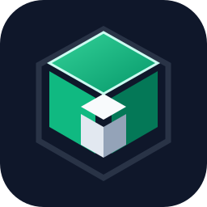

<div align="center">



# Laravel Foundry

**A Docker-first, frontend-neutral Laravel development template.**

[](https://github.com/sempitern0/laravel-foundry/actions/workflows/ci.yml)
[](LICENSE)
[](compose.yaml)
[](#requirements)

**Bring your own Laravel starter. No Sail, Herd, required SaaS, or paid local database.**

[Quick start](#quick-start) · [Architecture](#architecture) · [Commands](#daily-commands) · [HTTPS](#local-https-with-caddy) · [Hosting providers](docs/HOSTING_PROVIDERS.md) · [SaaS / multi-tenancy](docs/SAAS.md) · [Troubleshooting](#troubleshooting)

</div>

> [!IMPORTANT]
> This is an **infrastructure template, not a Laravel application repository**. Generated application source under `app/` can be versioned; secrets, dependencies and runtime files remain ignored. Release/staging configurations are **reference starting points**, not a verified turnkey production deployment. Never commit secrets.

## At a glance

| Area | Choice |
| --- | --- |
| Backend | Laravel, PHP 8.4-FPM, Nginx |
| Starter | Plain Laravel · Svelte + Inertia · Vue + Inertia · React + Inertia · Livewire |
| Database | PostgreSQL · MariaDB · MySQL · SQLite |
| Queues | Sync · Database · Redis |
| Email | Mailpit · Log · Custom SMTP |
| Database UI | Pgweb · phpMyAdmin · Adminer · None |
| HTTPS | Caddy local CA, custom `.test` hostname |
| Development tools | Disposable Composer container, separate PHP-capable Node/Vite container |
| Host support | Native PowerShell, Linux, macOS, WSL2 |
| Delivery | Docker Compose; optional image-release workflow via GHCR |

## AI coding agents

[**AGENTS.md**](AGENTS.md) is the repository's framework-agnostic development guide for AI coding assistants. It covers initial repository discovery, Laravel/PHP and PSR conventions, Eloquent models and migrations, authorization, security, queue jobs, Docker tooling, testing, and frontend rules for **Blade, Livewire, Inertia with Svelte/Vue/React** and other installed tools. It avoids imposing a frontend or unnecessary architecture.

The guide is stored at the **template root**, so an assistant working on Laravel Foundry follows its infrastructure standards. If you create a separate *application repository* from `app/`, include an adapted copy of `AGENTS.md` there so the project's own agents retain the relevant Laravel standards. Review its Docker command assumptions and any project-specific rules before copying.

## Quick start

Requirements: Docker Desktop with Linux containers (Windows) or Docker Engine (Linux), **Compose v2**, Git, and GNU Make for the Makefile shortcuts. PHP, Node, Composer, npm and database engines run inside containers.

**Windows prerequisites:** `make setup` cannot install GNU Make because it is itself invoked by Make. Before cloning/running Make on a new machine, use the native PowerShell helper:

```powershell
.\scripts\prerequisites.ps1
.\scripts\prerequisites.ps1 -InstallMissing
```

The first command only audits prerequisites; the second **asks for consent** before installing missing Git/Docker Desktop with WinGet and GNU Make through an available supported package manager (Chocolatey, Scoop, or a verified WinGet package). If no supported Make package is discoverable, the helper provides a manual installation path; it does **not** silently install arbitrary package managers. Docker Desktop/WSL2 may need an administrator, a reboot and first-run initialization. Start Docker Desktop before running setup.

**No Make required:** after Docker Desktop is working, you may use `.\scripts\setup.ps1 -Starter svelte` directly from PowerShell. The project does not silently alter the host system during `make setup`.

```powershell
git clone https://github.com/sempitern0/laravel-foundry.git my-laravel-app
cd my-laravel-app
make setup STARTER=svelte
```

Or use `make setup` to choose a starter interactively. The setup wizard asks for a Compose project name, application name, database, queue, email, database UI, and optional HTTPS hostname. For a plain Laravel application use `STARTER=laravel`.

Windows without Make:

```powershell
.\scripts\setup.ps1 -Starter svelte
```

Linux/macOS/WSL:

```sh
sh scripts/setup.sh svelte
```

**Existing `app/`:** setup/build preserve the current installation without a keep/replace prompt. Replacement requires an explicit, confirmed `make reset-project`. The first run downloads official starter code and dependencies, removes Sail, sets up the chosen database, migrates and prepares assets. First setup may take time; daily startup should not repeat it.

## Architecture

```text
                        Browser
                   HTTP or local HTTPS
                           |
                     Caddy (optional)
                           |
                         Nginx
                           |
                       Laravel
                       PHP-FPM
                           |
              +------------+-------------+
              |                          |
      PostgreSQL/MariaDB/SQLite     Queues / Redis
              |
       Pgweb / Adminer (optional)

    On-demand tools: Composer + PHP + Node/npm
    Frontend:        Node + PHP CLI (Wayfinder) + Vite
    Test email:      Mailpit
```

The PHP-FPM runtime does not carry Composer or npm. The disposable Composer toolbox contains Node/npm because official Laravel starter hooks may invoke npm. The Node/Vite container contains PHP CLI because Wayfinder can invoke `php artisan` while building frontend assets. Containers share project files and selected Docker volumes; networks are separation of responsibilities, **not a full sandbox for untrusted dependencies**.

## Daily commands

| Command | Purpose |
| --- | --- |
| `make up` | **Fast** detached creation/start; does not wait for full health |
| `make up-detached` | Compatibility alias for `make up` |
| `make up-wait` | Start and wait for declared container healthchecks |
| `make up-logs` | Run Compose in foreground |
| `make stop` / `make start` | Quick daily pause/resume without recreating containers |
| `make down` | Stop and remove containers/networks; **keep volumes** |
| `make restart` | Stop/start existing containers |
| `make images` | Image-only build after Dockerfile changes |
| `make ps` / `make logs` | Inspect containers and logs |
| `make artisan CMD="route:list"` | Laravel Artisan |
| `make composer CMD="require vendor/package"` | Composer in disposable toolbox |
| `make npm CMD="run build"` | Node/Vite tool container |
| `make migrate` / `make test` / `make lint` | Laravel operations |
| `make env-sync` | Add missing root `.env` keys without overwriting values |
| `make backup` | Export **local** database dump (not offsite backup) |
| `make https-setup` | Local hostname/certificate guidance and Windows helper |
| `make reset-project` | **Destructive** full reset of generated app and Compose volumes |
| `make build` / `make rebuild` | Restore configured environment, dependencies, migrations and assets / additionally recreate services |
| `make config` | Validate Compose configuration |

### Fast startup versus readiness

`make up` is the default quick path: it uses detached Compose startup. Nginx and Caddy depend on their upstream containers **starting**, not each passing a serial 20-second readiness gate. Healthchecks remain enabled and probe rapidly during startup. If you need to know that the stack is ready rather than merely started, run `make up-wait`.

After the first setup, prefer `make stop` and `make start` for short daily development sessions; these retain Docker containers. **Do not use `make reset-project` to restart an app.** Initial cold starts, database recovery, image pulls and Windows filesystem performance still take variable time. Fast startup is **not a promise of a particular latency**.

## Local HTTPS with Caddy

Choose local HTTPS in the setup wizard. For a custom name like `your-project.test`, add `127.0.0.1 your-project.test` to your hosts file (Windows: `C:\Windows\System32\drivers\etc\hosts`; Linux/macOS: `/etc/hosts`). Port **443** is the new-installation default, so the URL is:

**https://your-project.test**

On Windows use `make https-setup` to guide hostname setup and offer to trust the local Caddy CA after confirmation. You must trust the CA in your OS/browser to avoid certificate warnings. Firefox may use its own certificate settings. Caddy's `tls internal` certificates are **development-only**, not public ACME certificates. If port 443 is occupied, choose another `HTTPS_PORT` (e.g. 8443) and append it to the URL. The wizard configures `app/.env` `APP_URL` accordingly.

Both HTTPS helpers retry certificate export up to ten times while Caddy initializes its local CA. Windows PowerShell 5.1 handles Docker progress output without treating it as a failed command; actual nonzero exit codes still fail setup. Certificate trust remains explicit.

Existing installations keep their current `HTTPS_PORT` until you change it. For a pre-existing installation, change the root `.env` and Laravel `APP_URL`, recreate Caddy and clear Laravel's cached configuration.

## Environment and project lifecycle

- **`.env.example`:** safe, generic defaults committed to the template.
- **Root `.env`:** generated project-specific Compose/wizard settings; ignored by Git.
- **`app/.env`:** generated Laravel environment; ignored by Git.
- **`make env-sync`:** adds missing keys from the latest template, **never overwrites** existing values, secrets, or custom settings.
- **`app.production.env.example` / `db.production.env.example`:** separate production references; do not copy development credentials into production.

To replace everything generated with a new app:

```powershell
make reset-project
make setup STARTER=livewire
```

Reset requires typing `RESET <PROJECT_NAME>`. It removes the generated `app/`, root `.env`, and **all volumes of that Compose project** (including database data and Caddy CA). It **preserves** `backups/`, `app-backups/`, the template files, and does not revoke system certificate trust or modify hosts. **Back up data before resetting.**

## Local → staging → production: deploying the same tested release

**[Deployment and environment-parity guide (step-by-step) →](docs/DEPLOYMENT.md)** · **[Compare VPS, Forge, Laravel Cloud and App Platform →](docs/HOSTING_PROVIDERS.md)**

| Environment | How it runs | What it verifies |
| --- | --- | --- |
| Development | `compose.yaml`, bind-mounted code and development tools | Fast editing and automated tests |
| Local production-parity | `compose.production.yaml`, release images and local-only Caddy | The real PHP/Nginx artifact, PostgreSQL, production configuration |
| Staging | **Same immutable image versions**, separate database, secrets, real TLS | Migrations, integrations, smoke tests |
| Production | **Promote the exact images already checked in staging** | Live workload |

**“Develop locally like production” means reproducible runtime and behavior, not identical secrets/data.** Match PHP extensions, database **engine/major version**, Composer/npm lockfiles, asset build, migrations and relevant infrastructure features. Keep `APP_KEY`, credentials, user data, email/payment gateways, domains and volumes separate. Local development can use Vite/debug tools, but verify the candidate release through the **same production Compose images** before promotion.

> [!WARNING]
> Commit generated application source and lockfiles in the product repository before publishing release images. Current production Compose supports PostgreSQL; local MariaDB/MySQL/SQLite choices do **not** imply production parity until that topology is explicitly adapted. Production backups, restore drills, deployment approvals and rollback plans are mandatory and are not automated by this template.

## Troubleshooting

| Symptom | Check |
| --- | --- |
| `http://localhost:8080` fails | `docker compose ps`, `docker compose logs web app`, then `http://localhost:8080/healthz` |
| `https://*.test` fails | Check `hosts`, `HTTPS_PORT`, `COMPOSE_PROFILES`, port ownership and `docker compose logs caddy-local` |
| Browser says HTTPS is not trusted | Run `make https-setup`, review and explicitly trust **your own** Caddy CA |
| Wayfinder build says `php: not found` | Rebuild Node frontend image: `docker compose build node` |
| `composer install` invokes npm | Use the Composer toolbox, which includes Node/npm for Laravel hooks |
| Windows clone/copy fails | Use the bootstrap copy helper and Docker-managed `node_modules`, not `git clone` into a mounted populated directory |
| Slow repeated startups | Use `make start` after `make stop`, or `make up` rather than `make up-wait` |
| Environment file is missing keys | `make env-sync` (preserves existing values) |

## Contributing

Unix scripts run with POSIX `sh` (including Bash and Debian/Ubuntu's Dash).
Setup checks Docker CLI, Compose and Engine availability before changing local
configuration. Windows CRLF `.env` files are supported, and rebuilds preserve an
existing `APP_KEY`. Run `python3 tests/unix-portability.py` for isolated regression
checks with mocked Docker/curl; this does not replace a real container build.

Issues and pull requests are welcome. Test shell paths on Linux/WSL and PowerShell paths on Windows when modifying setup; do not commit application source into the pristine template. Before proposing infrastructure changes, validate `docker compose config -q` and run the CI workflow.

## License

Released under the [MIT License](LICENSE). © 2026 sempitern0.

### Naming and compatibility

The project name is configured in the setup wizard and identifies its Docker Compose resources. Keep it stable for existing installations.

The setup uses `scripts/configure-app.php` for Laravel environment configuration. Use `make reset-project` (with explicit confirmation) for a complete reset. For production releases `docker/php/Production.Dockerfile` remains separate from the development toolbox.

The repository icon is an original geometric mark evoking modular building blocks. It is not the official Laravel or Docker brand mark.


### MySQL and MariaDB setup

In `make setup`, select `mysql` or `mariadb`, then choose `phpmyadmin` as your database UI (default for new MySQL/MariaDB projects) or `adminer`. The UI is reachable on the host at `http://localhost:8081`; no database port is exposed to the LAN. Run `make reset-project` with explicit confirmation when intentionally deleting a database and application to start fresh; changing engines with existing data requires a deliberate migration, not just editing `.env`.


## SaaS / multi-tenancy (optional)

The interactive wizard can record an optional `TENANCY_MODE`: `none`, `shared-db` or `database-per-tenant`. Enabling it configures **local SaaS routing** with Caddy for apex and wildcard subdomains when HTTPS is selected, e.g. `alpha.foundry.test` and `beta.foundry.test`. Run `make tenancy-check` to smoke-test tenant hostname routing. **This is a development blueprint, not built-in tenant isolation or package installation.** Laravel tenant resolvers, tenant-owned queries, access control, queue propagation and data-isolation tests remain the application's responsibility.

[**SaaS architecture, package comparisons and isolation testing guide →**](docs/SAAS.md)

### Tests and starter customization

See [Testing and customizing starters](docs/TESTING_AND_STARTERS.md) for Docker test environments, CSRF 419 failures, product authorization tests, disabled Fortify routes with Wayfinder, and Svelte/font warnings. `make test CMD="--filter=AuthenticationTest"` runs a focused suite in the testing environment.

### Resume a configured project on another device

`make build` now restores the saved project choices, installs dependencies,
compiles assets and starts the local environment. Commit the generated
`.foundry.json` **with your product's app source and lockfiles**, never its `.env`
or credentials. Existing local configuration is preserved until explicit
reconfiguration/reset. Use `make images` for image-only builds.
See [portable setup and rebuild](docs/PROJECT_REBUILD.md) for the clone workflow,
Windows usage, reset behavior and local-secret requirements.


### Versioning application source

Foundry's root `.gitignore` intentionally allows application source under
`app/` to be versioned once a starter is generated. It still excludes the
local Laravel environment, dependencies, runtime storage, SQLite files and
compiled assets. Commit application source and lockfiles alongside
`.foundry.json` for reproducible clones; never commit secrets.

### Resumen de servicios al iniciar

Tras `make setup` o `make up`, Foundry presenta un resumen del proyecto, configuración (sin secretos), estado de los contenedores y enlaces HTTP/HTTPS a las GUIs realmente levantadas (Laravel, Mailpit y pgweb/phpMyAdmin/Adminer si están habilitados). Para volver a mostrarlo sin reiniciar servicios usa `make status`. El estado `running` no equivale a una comprobación HTTP; consulta `make up-wait` para esperar healthchecks. Consulta [configuración portable](docs/PROJECT_REBUILD.md) para más información.
